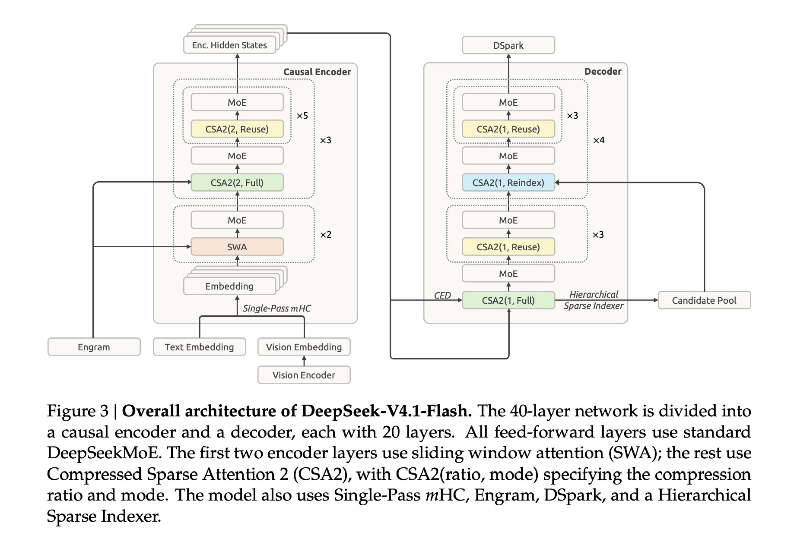
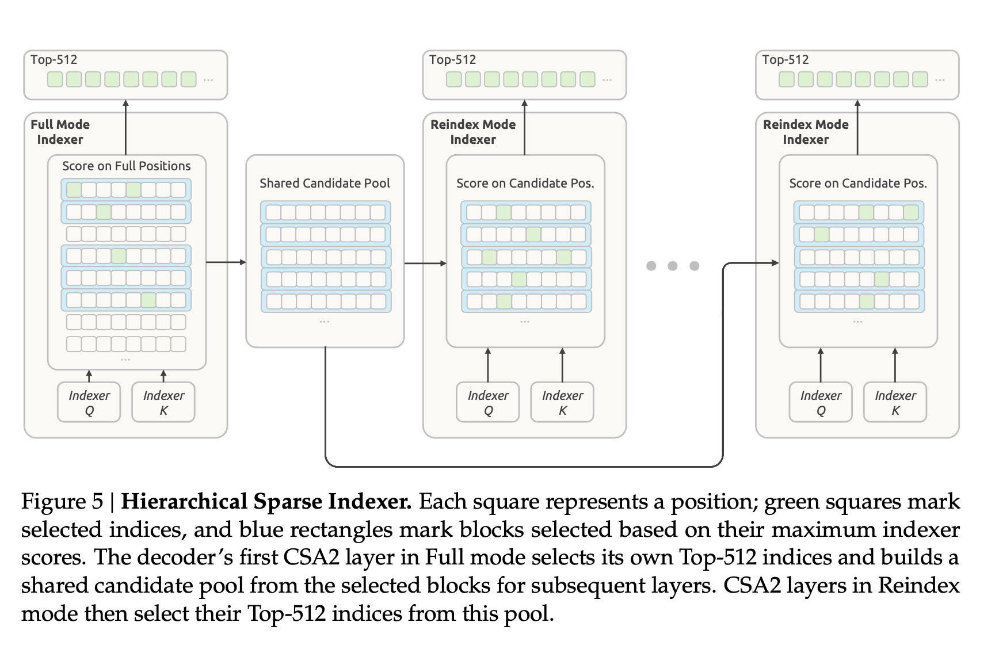



## 1. Summary

DeepSeek-V4.1-Flash, is multimodal Mixture-of-Experts (MoE) architecture with **552B total parameters** that optimizes persistent KV caches to near-theoretical limits while outperforming previous models. The highlights are:

- **Activation parameters**: **552B** backbone parameters and **196B Engram** parameters, activating **8B** parameters per token during prefill and **16B** during decode
- **CSA2**(Compressed Sparse Attention 2 for global KV): heavily leveraging **cross-layer reuse** of global KV (main KV + indexer K) and sparse indices
- **FP4 Global KV caches**: lowers runtime HBM footprint to **890 bytes per token** (approx. **$\frac{1}{4}$** **of DeepSeek-V4-Flash** and $\sim\mathbf{437\times}$ smaller than DeepSeek-V1)
- **SWA**(Sliding-Window Attention for local KV): eliminates the need to save SWA KV to disk/SSD, slashing persistent KV cache footprint to **$\approx \frac{1}{8}$ of DeepSeek-V4-Flash**
- **Single-Pass mHC**: cuts activation memory traffic by 50%.
- **Engram Conditional Memory**: augments capacity
- **DSpark Speculative Decoding**: keeps per-token decode FLOPs virtually flat as context expands from 4K up to 1M tokens

## 2. Method
- With Causal Encoder-Decoder (**CED**) architecture,  the model comprises 40 causal Transformer layers, organized into a 20-layer causal encoder followed by a 20-layer decoder. Each layer incorporates both global attention and sliding window attention (SWA), except for the first two layers, which use SWA only
- For the upper half layers (i.e., the decoder, $𝑙 > 𝐿/2$), the global KV entries projected directly from the hidden state of the ($𝐿/2$)-th layer, $𝐻_{𝐿/2}$, using layer-dependent projection weights ($𝑊_{l}^{𝐾𝑉}$and $𝑊_{l}^{𝑍}$ ): $𝐶_l = 𝐻_{𝐿/2}𝑊_{l}^{𝐾𝑉}$, $𝑍_l = 𝐻_{𝐿/2}𝑊_{l}^{𝑍}$, $𝑙 > 𝐿/2$ ,  where 𝐶 and 𝑍 represent the KV entries and their corresponding compression weights, respectively.
- SWA, not persisted on SSD, is recomputed/replayed during inference but limited to last 128 tokens. The encoder SWA replay is triggered by new prompt context appending; the decoder SWA replay is triggered by generation. 
- CSA2 has three operating modes
	- **Full Mode**: computes its own main KV and indexer Q, projects indexer K from that main KV, and runs the indexer to produce fresh Top-K indices
	- **Reindex Mode**: reuses main KV and indexer K from last layer, computes its own query, rescores the reused keys, and produces fresh Top-K indices
	- **Reuse Mode**: reuses the most recent available main KV and the latest Top-K indices



## 3. Layer-by-Layer Architectural Matrix

| **Layer Range**  | **Structural Role**       | **Local Attention**        | **Global Attention (CSA2 Mode)**  | **Memory / MoE Architecture**       | **Residual & KV Cache State**                                            |
| ---------------- | ------------------------- | -------------------------- | --------------------------------- | ----------------------------------- | ------------------------------------------------------------------------ |
| **Layer 1**      | Causal Encoder Entry      | SWA ($n_{\text{win}}=128$) | _None_ (Pure local)               | Dense / MoE (384 routed + 1 shared) | Single-Pass mHC; **Zero Global KV** allocated                            |
| **Layer 2**      | Entity Disambiguation     | SWA ($n_{\text{win}}=128$) | _None_ (Pure local)               | **Engram Conditional Memory** + MoE | Single-Pass mHC; Multi-head $N$-gram hash lookup                         |
| **Layer 3**      | Encoder Group 1 Root      | SWA ($n_{\text{win}}=128$) | **Full Mode**                     | MoE (384 routed + 1 shared)         | Single-Pass mHC; **Materializes Global KV 1** (FP4)                      |
| **Layers 4–8**   | Encoder Group 1 Followers | SWA ($n_{\text{win}}=128$) | **Reuse Mode**                    | MoE (384 routed + 1 shared)         | Single-Pass mHC; Reuses Group 1 pointers & indices                       |
| **Layer 9**      | Encoder Group 2 Root      | SWA ($n_{\text{win}}=128$) | **Full Mode**                     | MoE (384 routed + 1 shared)         | Single-Pass mHC; **Materializes Global KV 2** (FP4)                      |
| **Layers 10–14** | Encoder Group 2 Followers | SWA ($n_{\text{win}}=128$) | **Reuse Mode**                    | MoE (384 routed + 1 shared)         | Single-Pass mHC; Reuses Group 2 pointers & indices                       |
| **Layer 15**     | Encoder Group 3 Root      | SWA ($n_{\text{win}}=128$) | **Full Mode**                     | **Engram Table 2** (optional) + MoE | Single-Pass mHC; **Materializes Global KV 3** (FP4)                      |
| **Layers 16–20** | Encoder Group 3 Followers | SWA ($n_{\text{win}}=128$) | **Reuse Mode**                    | MoE (384 routed + 1 shared)         | Single-Pass mHC; Emits final encoder state ($h_{\text{enc}}$)            |
| **Layer 21**     | Decoder Entry / Root      | SWA ($n_{\text{win}}=128$) | **Full Mode** (Candidate Pool)    | MoE (384 routed + 1 shared)         | Projects $h_{\text{enc}} \to$ **Decoder Main KV** (FP4); builds 16K pool |
| **Layers 22–24** | Decoder Group 1 Followers | SWA ($n_{\text{win}}=128$) | **Reuse Mode**                    | MoE (384 routed + 1 shared)         | Reuses Decoder Main KV and Top-$K$ candidate routing                     |
| **Layer 25**     | Decoder Group 2 Rescorer  | SWA ($n_{\text{win}}=128$) | **Reindex Mode**                  | MoE (384 routed + 1 shared)         | Reuses Main KV; rescores within 16K candidate pool                       |
| **Layers 26–28** | Decoder Group 2 Followers | SWA ($n_{\text{win}}=128$) | **Reuse Mode**                    | MoE (384 routed + 1 shared)         | Inherits Layer 25 Top-$K$ block indices                                  |
| **Layer 29**     | Decoder Group 3 Rescorer  | SWA ($n_{\text{win}}=128$) | **Reindex Mode**                  | MoE (384 routed + 1 shared)         | Reuses Main KV; rescores within 16K candidate pool                       |
| **Layers 30–32** | Decoder Group 3 Followers | SWA ($n_{\text{win}}=128$) | **Reuse Mode**                    | MoE (384 routed + 1 shared)         | Inherits Layer 29 Top-$K$ block indices                                  |
| **Layer 33**     | Decoder Group 4 Rescorer  | SWA ($n_{\text{win}}=128$) | **Reindex Mode**                  | MoE (384 routed + 1 shared)         | Reuses Main KV; rescores within 16K candidate pool                       |
| **Layers 34–36** | Decoder Group 4 Followers | SWA ($n_{\text{win}}=128$) | **Reuse Mode**                    | MoE (384 routed + 1 shared)         | Inherits Layer 33 Top-$K$ block indices                                  |
| **Layer 37**     | Decoder Group 5 Rescorer  | SWA ($n_{\text{win}}=128$) | **Reindex Mode**                  | MoE (384 routed + 1 shared)         | Reuses Main KV; rescores within 16K candidate pool                       |
| **Layers 38–40** | Decoder Group 5 Followers | SWA ($n_{\text{win}}=128$) | **Reuse Mode** + **DSpark Heads** | MoE (384 routed + 1 shared)         | Semi-AR drafting heads for speculative decoding                          |

## 4. Personal Insights
- For each token, Main KV stores a single **compressed latent representation** $c_t^{KV} \in \mathbb{R}^{512}$.alongside $k_{t,\text{pe}} \in \mathbb{R}^{64}$ hat carries the RoPE frequencies. $c_t^{KV}$ contains **both Key and Value information simultaneously** in a shared low-rank manifold. All heads share the single $c_t^{KV}$.
- In the causal encoder, layers share KV across 3 groups; In the decoder, all 20 layers share **1 single Main KV cache** projected from the encoder's final state. So The layer dimension is collapsed from 40 down to 4. The Main KV dimension is [ 4 Shared Cache Groups ] x [ Seq_Len ] x (  $c_t^{KV}$[512] + $k_{t,\text{pe}}$ [64] ) 
- For a decoding token at position $t$ generating an attention output across all past tokens $j \le t$ 
	- **Generating the Split Query**: Split the query $h_t$ into $q_{t,i}^C \in \mathbb{R}^{d_h}$ and $q_{t,i}^R \in \mathbb{R}^{d_{\text{pe}}}$ for head $i$ in which $d_h = 128$, $d_{\text{pe}} = 64$
	- **Attention Logit Computation**: In naive MHA, the key would be expanded via up-projection matrix $W_{UK, i} \in \mathbb{R}^{512 \times 128}$:$$k_{j,i}^C = c_j^{KV} W_{UK, i}$$Because matrix multiplication is associative, DeepSeek **absorbs $W_{UK, i}$ into the query vector at inference time**$$\tilde{q}_{t,i}^C = q_{t,i}^C W_{UK, i}^T \in \mathbb{R}^{512}$$The attention score $S_{t, j, i}$ between current query token $t$ and cached token $j$ for head $i$ splits into content and position:$$S_{t, j, i} = \frac{1}{\sqrt{d_h + d_{\text{pe}}}} \Big( \underbrace{\tilde{q}_{t,i}^C \cdot c_j^{KV}}_{\text{Content Match (512-d)}} + \underbrace{q_{t,i}^R \cdot k_j^{\text{pe}}}_{\text{Positional Match (64-d)}} \Big)$$
	- **Value Aggregation & Output Projection**: After computing softmax probabilities $A_{t, j, i} = \text{Softmax}_j(S_{t, j, i})$, the head output is naively, $$o_{t,i} = \sum_j A_{t, j, i} \cdot v_{j,i} = \sum_j A_{t, j, i} \cdot (c_j^{KV} W_{UV, i})$$MLA absorbs the value up-projection $W_{UV, i}$ directly into the final output projection matrix $W_O$:$$\tilde{v}_{t,i} = \sum_j A_{t, j, i} \cdot c_j^{KV} \in \mathbb{R}^{512}$$
		$$u_t = \sum_{i=1}^{n_{\text{heads}}} \tilde{v}_{t,i} \cdot W_{absorbed, i}^O \quad \text{where } W_{absorbed, i}^O = W_{UV, i} W_{O, i}$$the final layer output $u_t$ is then passed to the Single-Pass mHC residual mixer.
- Sample code
```python
import math
import torch
import torch.nn.functional as F

# Hyperparameters
batch_size = 1
seq_len = 4          # Number of tokens in KV cache
d_model = 2048       # Layer hidden dimension
n_heads = 16         # Number of attention heads
d_h = 128            # Head dimension
d_c = 512            # Latent KV compression dimension
d_pe = 64            # Decoupled RoPE dimension

# 1. Mock Cached Tensors (Stored in HBM per token)
# c_latent: [batch, seq_len, d_c]
c_latent = torch.randn(batch_size, seq_len, d_c)
# k_rope: [batch, seq_len, d_pe] (shared across heads)
k_rope = torch.randn(batch_size, seq_len, d_pe)

# 2. Weights for the layer
# Weights to produce the absorbed query directly from hidden state:
W_q_absorbed = torch.randn(d_model, n_heads, d_c)   # Absorbs W_UK into Query
W_q_rope = torch.randn(d_model, n_heads, d_pe)       # Produces RoPE queries
# Value/Out absorbed projection:
W_out_absorbed = torch.randn(n_heads, d_c, d_model) # Absorbs W_UV into W_out

# 3. Step: New incoming hidden state for the current decoding token
h_current = torch.randn(batch_size, 1, d_model)  # [1, 1, 2048]

# --- Step A: Project current token query ---
# q_content: [batch, heads, 1, d_c]
q_content = torch.einsum("b s d, d h c -> b h s c", h_current, W_q_absorbed)
# q_rope: [batch, heads, 1, d_pe] (assume RoPE rotation applied)
q_rope = torch.einsum("b s d, d h p -> b h s p", h_current, W_q_rope)

# --- Step B: Compute Attention Scores via cached c_latent & k_rope ---
# Content score: q_content dot-product c_latent (Dimension 512)
# [b, h, 1, d_c] x [b, s, d_c] -> [b, h, 1, seq_len]
score_content = torch.einsum("b h q c, b s c -> b h q s", q_content, c_latent)

# Positional score: q_rope dot-product k_rope (Dimension 64)
# k_rope broadcasts across all heads!
# [b, h, 1, d_pe] x [b, s, d_pe] -> [b, h, 1, seq_len]
score_rope = torch.einsum("b h q p, b s p -> b h q s", q_rope, k_rope)

# Combine and apply scaling
scale = 1.0 / math.sqrt(d_h + d_pe)
attn_logits = (score_content + score_rope) * scale
attn_weights = F.softmax(attn_logits, dim=-1)  # [batch, heads, 1, seq_len]

# --- Step C: Aggregate Latents and Compute Hidden Output ---
# Instead of decompressing V for every head, multiply attn weights with c_latent:
# [b, h, 1, s] x [b, s, d_c] -> [b, h, 1, d_c]
v_latent_aggregated = torch.einsum("b h q s, b s c -> b h q c", attn_weights, c_latent)

# Project directly to final hidden state using absorbed W_out:
# [b, h, 1, d_c] x [h, d_c, d] -> [b, 1, d]
layer_output = torch.einsum("b h q c, h c d -> b q d", v_latent_aggregated, W_out_absorbed)

print("Updated Hidden State Shape:", layer_output.shape)
# Output: torch.Size([1, 1, 2048])
```
