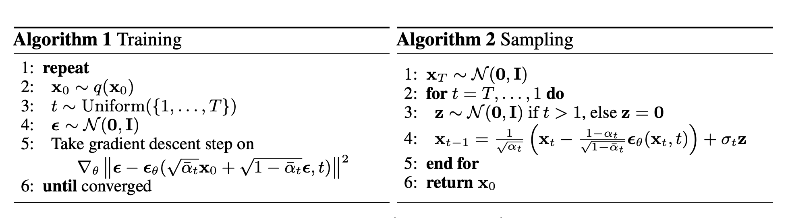



## 1. Summary
Denoising Diffusion Probabilistic Models (**DDPM**) redesigned the **parameterization** and the **loss objective** of diffusion models, proving they could generate high-fidelity samples (**FID** $3.17$ on **CIFAR-10**) competitive with, and in many respects superior to, Generative Adversarial Networks (**GAN**s) and autoregressive models/**VAE**s.

## 2. Method
- **Forward (Inference) Process $q$**: take an image $x_0$, pick a random difficulty level $t \in [1, T]$, and generate standard Gaussian noise $\epsilon \sim \mathcal{N}(0, \mathbf{I})$. Blend them directly to produce the marred image $$x_t = \sqrt{\bar{\alpha}_t}x_0 + \sqrt{1 - \bar{\alpha}_t}\epsilon$$. input the marred instance $x_t$ and the timestep $t$ to a model (e.g. U-Net) to predict the injected noise $\epsilon$ with the loss function $$\mathcal{L} = \Vert{}\epsilon - \epsilon_\theta(x_t, t)\Vert{}^2$$
- **Reverse (Generative) Process $p_\theta$:**  start with a pure gaussian noise $x_T\sim \mathcal{N}(0, \mathbf{I})$ and iterate $T$ steps. At each step, subtract a fraction of the predicted noise to shift the sample closer to the data manifold $$\mu_\theta(x_t, t) = \frac{1}{\sqrt{\alpha_t}} \left( x_t - \frac{\beta_t}{\sqrt{1 - \bar{\alpha}_t}} \epsilon_\theta(x_t, t) \right)$$
$$x_{t-1} = \mu_\theta(x_t, t) + \sigma_t z, \quad z \sim \mathcal{N}(0, \mathbf{I})$$ at the end, reach the final clean image $x_0$.

## 3. Key Mathematical Formulations
- **The core probabilistic problem**: The goal of any generative model is to maximize the log-likelihood of real data under the model: $$\max_\theta \mathbb{E}_{x_0 \sim q(x_0)} \left[ \log p_\theta(x_0) \right]$$ that can be reduced to optimize the **Variational Lower Bound (ELBO)** using Jensen's Inequality:$$\log p_\theta(x_0) \ge \mathbb{E}_{q(x_{1:T} \mid x_0)} \left[ \log \frac{p_\theta(x_{0:T})}{q(x_{1:T} \mid x_0)} \right] = -L_{\text{VLB}}$$Furthermore, $L_{\text{VLB}}$ can be expanded as follows using Bayes' theorem on Markov chains:$$L_{\text{VLB}} = \mathbb{E}_q \Big[ \underbrace{D_{\text{KL}}\left(q(x_T \mid x_0) \,\Vert{}\, p(x_T)\right)}_{L_T: \text{ Prior Matching}} + \sum_{t > 1} \underbrace{D_{\text{KL}}\left(q(x_{t-1} \mid x_t, x_0) \,\Vert{}\, p_\theta(x_{t-1} \mid x_t)\right)}_{L_{t-1}: \text{ Denoising Matching}} - \underbrace{\log p_\theta(x_0 \mid x_1)}_{L_0: \text{ Reconstruction}}\Big]$$in which $L_T, L_0$ are nearly constant, the formula turns out to be minimizing the KL divergence between two distributions: $$L_{t-1} = D_{\text{KL}}\left( q(x_{t-1} \mid x_t, x_0) \,\Vert{}\, p_\theta(x_{t-1} \mid x_t) \right)$$Both distributions are Gaussians with isotropic covariances.Target distribution: $q(x_{t-1} \mid x_t, x_0) = \mathcal{N}\left(x_{t-1};\, \tilde{\mu}_t(x_t, x_0),\, \sigma_t^2 \mathbf{I}\right)$ and Model distribution: $p_\theta(x_{t-1} \mid x_t) = \mathcal{N}\left(x_{t-1};\, \mu_\theta(x_t, t),\, \sigma_t^2 \mathbf{I}\right)$. So, $$L_{t-1} = \frac{1}{2\sigma_t^2} \left\Vert{} \tilde{\mu}_t(x_t, x_0) - \mu_\theta(x_t, t) \right\Vert{}^2$$ while the ground-truth posterior mean is: $$\tilde{\mu}_t(x_t, x_0) = \frac{1}{\sqrt{\alpha_t}} \left( x_t - \frac{\beta_t}{\sqrt{1 - \bar{\alpha}_t}} \epsilon \right)$$ where $\epsilon$ is the true noise added to create $x_t$. We can define the neural network parameterization of $\mu_\theta(x_t, t)$ with the exact same functional form:$$\mu_\theta(x_t, t) = \frac{1}{\sqrt{\alpha_t}} \left( x_t - \frac{\beta_t}{\sqrt{1 - \bar{\alpha}_t}} \epsilon_\theta(x_t, t) \right)$$As a result, $$\tilde{\mu}_t - \mu_\theta = -\frac{\beta_t}{\sqrt{\alpha_t}\sqrt{1 - \bar{\alpha}_t}} \left( \epsilon - \epsilon_\theta(x_t, t) \right)$$

$$L_{t-1} = \frac{\beta_t^2}{2 \sigma_t^2 \alpha_t (1 - \bar{\alpha}_t)} \left\Vert{} \epsilon - \epsilon_\theta(x_t, t) \right\Vert{}^2$$
## 4. Personal Insights

### Mathematical Deduction of the ELBO

Let $x$ be an observed data point and $z$ be latent variables. The true marginal log-likelihood (evidence) is:

$$
\log p_\theta(x) = \log \int p_\theta(x, z) \, dz
$$

Directly computing this integral is intractable because the posterior $p_\theta(z \mid x) = \frac{p_\theta(x, z)}{p_\theta(x)}$ cannot be evaluated without knowing the evidence $p_\theta(x)$.

To resolve this, introduce an arbitrary proposal / approximate posterior distribution $q(z)$ (or $q_\phi(z \mid x)$) over the latent variables $z$, subject to the condition that $q(z) > 0$ whenever $p_\theta(x, z) > 0$.

### Method A: Deduction via Jensen's Inequality

**Insert $q(z)$ into the integral:**

$$
\log p_\theta(x) = \log \int p_\theta(x, z) \, dz = \log \int q(z) \frac{p_\theta(x, z)}{q(z)} \, dz
$$

**Rewrite as an expectation:**

$$
\log p_\theta(x) = \log \mathbb{E}_{z \sim q(z)} \left[ \frac{p_\theta(x, z)}{q(z)} \right]
$$

**Apply Jensen's Inequality:**

Because the logarithm function $f(u) = \log(u)$ is strictly concave ($\frac{d^2}{du^2}\log u = -\frac{1}{u^2} \lt 0$), for any random variable $Y$:

$$
f(\mathbb{E}[Y]) \ge \mathbb{E}[f(Y)] \implies \log \mathbb{E}[Y] \ge \mathbb{E}[\log Y]
$$

Substituting $Y = \frac{p_\theta(x, z)}{q(z)}$:

$$
\log \mathbb{E}_{z \sim q(z)} \left[ \frac{p_\theta(x, z)}{q(z)} \right] \ge \mathbb{E}_{z \sim q(z)} \left[ \log \frac{p_\theta(x, z)}{q(z)} \right]
$$

**Define the Evidence Lower Bound (ELBO):**

$$
\text{ELBO} \triangleq \mathbb{E}_{z \sim q(z)} \left[ \log \frac{p_\theta(x, z)}{q(z)} \right]
$$

$$
\log p_\theta(x) \ge \text{ELBO}
$$

### Method B: Deduction via KL Divergence (Exact Identity)

Evaluating the Kullback–Leibler (KL) divergence between the approximate posterior $q(z)$ and the true posterior $p_\theta(z \mid x)$:

$$
D_{\text{KL}}\left(q(z) \,\Vert{}\, p_\theta(z \mid x)\right) = \int q(z) \log \frac{q(z)}{p_\theta(z \mid x)} \, dz = \mathbb{E}_{z \sim q(z)} \left[ \log \frac{q(z)}{p_\theta(z \mid x)} \right]
$$

Using Bayes' rule, $p_\theta(z \mid x) = \frac{p_\theta(x, z)}{p_\theta(x)}$:

$$
\log \frac{q(z)}{p_\theta(z \mid x)} = \log \left( \frac{q(z) \cdot p_\theta(x)}{p_\theta(x, z)} \right) = \log q(z) - \log p_\theta(x, z) + \log p_\theta(x)
$$

Substitute this back into the expectation:

$$
D_{\text{KL}}\left(q(z) \,\Vert{}\, p_\theta(z \mid x)\right) = \mathbb{E}_{z \sim q(z)} [\log q(z)] - \mathbb{E}_{z \sim q(z)} [\log p_\theta(x, z)] + \mathbb{E}_{z \sim q(z)} [\log p_\theta(x)]
$$

Because $\log p_\theta(x)$ has no dependency on $z$, $\mathbb{E}_{z \sim q(z)} [\log p_\theta(x)] = \log p_\theta(x)$. Rearranging terms:

$$
\log p_\theta(x) = \mathbb{E}_{z \sim q(z)} \left[ \log \frac{p_\theta(x, z)}{q(z)} \right] + D_{\text{KL}}\left(q(z) \,\Vert{}\, p_\theta(z \mid x)\right)
$$

$$
\log p_\theta(x) = \text{ELBO} + D_{\text{KL}}\left(q(z) \,\Vert{}\, p_\theta(z \mid x)\right)
$$

Since the Gibbs inequality guarantees that KL divergence is strictly non-negative:

$$
D_{\text{KL}}\left(q(z) \,\Vert{}\, p_\theta(z \mid x)\right) \ge 0
$$

$$
\log p_\theta(x) \ge \text{ELBO}
$$

with equality holding if and only if $q(z) = p_\theta(z \mid x)$ almost everywhere.

### Standard Decompositions of the ELBO

Depending on how $p_\theta(x, z)$ is factored, the ELBO can be expressed in two primary forms:

**Reconstruction vs. Prior Regularization (Standard VAE View)**

Factor the joint probability as $p_\theta(x, z) = p_\theta(x \mid z) p(z)$:

$$
\begin{aligned}
\text{ELBO} &= \mathbb{E}_{q(z \mid x)} \left[ \log \frac{p_\theta(x \mid z) p(z)}{q(z \mid x)} \right] \\
&= \mathbb{E}_{q(z \mid x)} \left[ \log p_\theta(x \mid z) \right] + \mathbb{E}_{q(z \mid x)} \left[ \log \frac{p(z)}{q(z \mid x)} \right] \\
&= \underbrace{\mathbb{E}_{q(z \mid x)} \left[ \log p_\theta(x \mid z) \right]}_{\text{Reconstruction Fidelity}} - \underbrace{D_{\text{KL}}\left(q(z \mid x) \,\Vert{}\, p(z)\right)}_{\text{Prior Regularization}}
\end{aligned}
$$

**Joint Trajectory Expansion (DDPM / Markovian View)**

In diffusion models, $z = x_{1:T}$ represents the complete forward chain of latents. The joint distribution factors as $p_\theta(x_{0:T}) = p(x_T) \prod_{t=1}^T p_\theta(x_{t-1} \mid x_t)$, and the forward posterior factors as $q(x_{1:T} \mid x_0) = \prod_{t=1}^T q(x_t \mid x_{t-1})$.

Expanding $\mathbb{E}_{q} \left[ \log \frac{p_\theta(x_{0:T})}{q(x_{1:T} \mid x_0)} \right]$ using Bayes' rule on intermediate terms decomposes the ELBO into the sum of step-wise KL divergences:

$$
\text{ELBO} = \mathbb{E}_q \left[ \log p_\theta(x_0 \mid x_1) - D_{\text{KL}}\left(q(x_T \mid x_0) \,\Vert{}\, p(x_T)\right) - \sum_{t > 1} D_{\text{KL}}\left(q(x_{t-1} \mid x_t, x_0) \,\Vert{}\, p_\theta(x_{t-1} \mid x_t)\right) \right]
$$

### DDPM code
```python
import math
import torch
import torch.nn as nn
import torch.nn.functional as F


# ============================================================================
# 1. Timestep Embedding & Sub-Modules
# ============================================================================

class SinusoidalPositionEmbeddings(nn.Module):
    """
    Standard sinusoidal positional encoding mapping scalar timestep t to R^dim.
    """
    def __init__(self, dim: int):
        super().__init__()
        self.dim = dim

    def forward(self, t: torch.Tensor) -> torch.Tensor:
        device = t.device
        half_dim = self.dim // 2
        emb_scale = math.log(10000.0) / (half_dim - 1)
        emb = torch.exp(torch.arange(half_dim, device=device, dtype=torch.float32) * -emb_scale)
        emb = t.unsqueeze(1).float() * emb.unsqueeze(0)
        return torch.cat([torch.sin(emb), torch.cos(emb)], dim=-1)


class ResBlock(nn.Module):
    """
    Wide-ResNet style residual block with fused timestep conditioning.
    """
    def __init__(self, in_channels: int, out_channels: int, time_emb_dim: int, groups: int = 8):
        super().__init__()
        self.norm1 = nn.GroupNorm(groups, in_channels)
        self.act1 = nn.SiLU()
        self.conv1 = nn.Conv2d(in_channels, out_channels, kernel_size=3, padding=1)

        # Projects timestep vector to match feature channel depth
        self.time_proj = nn.Sequential(
            nn.SiLU(),
            nn.Linear(time_emb_dim, out_channels)
        )

        self.norm2 = nn.GroupNorm(groups, out_channels)
        self.act2 = nn.SiLU()
        self.conv2 = nn.Conv2d(out_channels, out_channels, kernel_size=3, padding=1)

        if in_channels != out_channels:
            self.shortcut = nn.Conv2d(in_channels, out_channels, kernel_size=1)
        else:
            self.shortcut = nn.Identity()

    def forward(self, x: torch.Tensor, t_emb: torch.Tensor) -> torch.Tensor:
        h = self.conv1(self.act1(self.norm1(x)))
        
        # Additive timestep injection projected across spatial dimensions
        h = h + self.time_proj(t_emb)[:, :, None, None]
        
        h = self.conv2(self.act2(self.norm2(h)))
        return h + self.shortcut(x)


class SelfAttention2d(nn.Module):
    """
    Spatial self-attention for capturing non-local image semantics at bottlenecks.
    """
    def __init__(self, channels: int, heads: int = 4):
        super().__init__()
        self.heads = heads
        self.channels = channels
        self.head_dim = channels // heads
        self.scale = self.head_dim ** -0.5

        self.norm = nn.GroupNorm(8, channels)
        self.qkv_conv = nn.Conv2d(channels, channels * 3, kernel_size=1, bias=False)
        self.out_conv = nn.Conv2d(channels, channels, kernel_size=1)

    def forward(self, x: torch.Tensor) -> torch.Tensor:
        B, C, H, W = x.shape
        norm_x = self.norm(x)
        qkv = self.qkv_conv(norm_x)
        q, k, v = torch.chunk(qkv, 3, dim=1)

        # Reshape to (B * Heads, H * W, Head_Dim)
        q = q.view(B, self.heads, self.head_dim, H * W).permute(0, 1, 3, 2).reshape(B * self.heads, H * W, self.head_dim)
        k = k.view(B, self.heads, self.head_dim, H * W).permute(0, 1, 3, 2).reshape(B * self.heads, H * W, self.head_dim)
        v = v.view(B, self.heads, self.head_dim, H * W).permute(0, 1, 3, 2).reshape(B * self.heads, H * W, self.head_dim)

        attn = torch.baddbmm(
            torch.empty(B * self.heads, H * W, H * W, device=x.device),
            q, k.transpose(-1, -2),
            beta=0.0, alpha=self.scale
        ).softmax(dim=-1)

        out = torch.bmm(attn, v)
        out = out.view(B, self.heads, H * W, self.head_dim).permute(0, 1, 3, 2).reshape(B, C, H, W)
        return x + self.out_conv(out)


# ============================================================================
# 2. Time-Conditioned U-Net Architecture
# ============================================================================

class UNet(nn.Module):
    """
    Isomorphic U-Net: preserves spatial resolution R^(B x C x H x W) -> R^(B x C x H x W).
    """
    def __init__(self, in_channels: int = 3, base_channels: int = 64, channel_mult: tuple = (1, 2, 4)):
        super().__init__()
        time_dim = base_channels * 4

        # Timestep MLP
        self.time_mlp = nn.Sequential(
            SinusoidalPositionEmbeddings(base_channels),
            nn.Linear(base_channels, time_dim),
            nn.SiLU(),
            nn.Linear(time_dim, time_dim)
        )

        self.conv_in = nn.Conv2d(in_channels, base_channels, kernel_size=3, padding=1)

        # Downsampling Encoder
        self.down_blocks = nn.ModuleList()
        self.down_samples = nn.ModuleList()
        current_ch = base_channels
        
        for mult in channel_mult:
            out_ch = base_channels * mult
            self.down_blocks.append(
                nn.ModuleList([
                    ResBlock(current_ch, out_ch, time_dim),
                    ResBlock(out_ch, out_ch, time_dim),
                ])
            )
            # Strided convolution downsampling
            self.down_samples.append(nn.Conv2d(out_ch, out_ch, kernel_size=3, stride=2, padding=1))
            current_ch = out_ch

        # Bottleneck (Mid-Block)
        self.mid_block1 = ResBlock(current_ch, current_ch, time_dim)
        self.mid_attn = SelfAttention2d(current_ch)
        self.mid_block2 = ResBlock(current_ch, current_ch, time_dim)

        # Upsampling Decoder
        self.up_samples = nn.ModuleList()
        self.up_blocks = nn.ModuleList()

        for mult in reversed(channel_mult):
            out_ch = base_channels * mult
            self.up_samples.append(
                nn.ConvTranspose2d(current_ch, current_ch, kernel_size=4, stride=2, padding=1)
            )
            self.up_blocks.append(
                nn.ModuleList([
                    ResBlock(current_ch + out_ch, out_ch, time_dim),
                    ResBlock(out_ch + out_ch, out_ch, time_dim),
                ])
            )
            current_ch = out_ch

        # Final projection layer to map back to original input channels
        self.norm_out = nn.GroupNorm(8, base_channels)
        self.act_out = nn.SiLU()
        self.conv_out = nn.Conv2d(base_channels, in_channels, kernel_size=3, padding=1)

    def forward(self, x: torch.Tensor, t: torch.Tensor) -> torch.Tensor:
        t_emb = self.time_mlp(t)
        h = self.conv_in(x)

        skip_connections = []
        for (res1, res2), downsample in zip(self.down_blocks, self.down_samples):
            h = res1(h, t_emb)
            skip_connections.append(h)
            h = res2(h, t_emb)
            skip_connections.append(h)
            h = downsample(h)

        h = self.mid_block1(h, t_emb)
        h = self.mid_attn(h)
        h = self.mid_block2(h, t_emb)

        for upsample, (res1, res2) in zip(self.up_samples, self.up_blocks):
            h = upsample(h)
            skip1 = skip_connections.pop()
            h = res1(torch.cat([h, skip1], dim=1), t_emb)
            skip2 = skip_connections.pop()
            h = res2(torch.cat([h, skip2], dim=1), t_emb)

        return self.conv_out(self.act_out(self.norm_out(h)))


# ============================================================================
# 3. DDPM Engine: Forward Schedule & Reverse Sampling
# ============================================================================

class DDPM(nn.Module):
    """
    DDPM Framework orchestrating forward diffusion corruption, 
    L_simple MSE training loss, and ancestral reverse generation.
    """
    def __init__(self, model: nn.Module, timesteps: int = 1000, beta_start: float = 1e-4, beta_end: float = 0.02):
        super().__init__()
        self.model = model
        self.timesteps = timesteps

        # Linear noise schedule constants
        beta = torch.linspace(beta_start, beta_end, timesteps, dtype=torch.float32)
        alpha = 1.0 - beta
        alpha_bar = torch.cumprod(alpha, dim=0)

        # Precompute buffers for closed-form forward sampling q(x_t | x_0)
        self.register_buffer("beta", beta)
        self.register_buffer("alpha", alpha)
        self.register_buffer("alpha_bar", alpha_bar)
        self.register_buffer("sqrt_alpha_bar", torch.sqrt(alpha_bar))
        self.register_buffer("sqrt_one_minus_alpha_bar", torch.sqrt(1.0 - alpha_bar))

        # Precompute reverse variance \tilde{\beta}_t
        alpha_bar_prev = F.pad(alpha_bar[:-1], (1, 0), value=1.0)
        posterior_variance = beta * (1.0 - alpha_bar_prev) / (1.0 - alpha_bar)
        self.register_buffer("posterior_variance", posterior_variance)

    def q_sample(self, x_0: torch.Tensor, t: torch.Tensor, noise: torch.Tensor = None) -> tuple[torch.Tensor, torch.Tensor]:
        """
        Forward process: samples x_t given clean x_0 and step t in closed form.
        """
        if noise is None:
            noise = torch.randn_like(x_0)

        sqrt_ab = self.sqrt_alpha_bar[t].view(-1, 1, 1, 1)
        sqrt_one_minus_ab = self.sqrt_one_minus_alpha_bar[t].view(-1, 1, 1, 1)

        x_t = sqrt_ab * x_0 + sqrt_one_minus_ab * noise
        return x_t, noise

    def compute_loss(self, x_0: torch.Tensor) -> torch.Tensor:
        """
        Calculates L_simple = || \epsilon - \epsilon_\theta(x_t, t) ||^2
        """
        batch_size = x_0.shape[0]
        t = torch.randint(0, self.timesteps, (batch_size,), device=x_0.device, dtype=torch.long)
        x_t, noise = self.q_sample(x_0, t)
        
        predicted_noise = self.model(x_t, t)
        return F.mse_loss(predicted_noise, noise)

    @torch.no_grad()
    def p_sample(self, x_t: torch.Tensor, t: int) -> torch.Tensor:
        """
        Single reverse Markov transition p_theta(x_{t-1} | x_t).
        """
        batch_size = x_t.shape[0]
        t_tensor = torch.full((batch_size,), t, device=x_t.device, dtype=torch.long)

        # 1. Model predicts injected noise
        pred_noise = self.model(x_t, t_tensor)

        # 2. Extract step constants
        a_t = self.alpha[t]
        a_bar_t = self.alpha_bar[t]
        beta_t = self.beta[t]

        # 3. Reconstruct posterior mean \mu_\theta(x_t, t)
        mean = (1.0 / torch.sqrt(a_t)) * (
            x_t - (beta_t / torch.sqrt(1.0 - a_bar_t)) * pred_noise
        )

        # 4. Inject stochastic noise z unless reaching step t = 0
        if t > 0:
            noise = torch.randn_like(x_t)
            variance = self.posterior_variance[t]
            return mean + torch.sqrt(variance) * noise
        else:
            return mean

    @torch.no_grad()
    def sample(self, shape: tuple, device: torch.device) -> torch.Tensor:
        """
        Full generative loop: draws x_T ~ N(0, I) and steps backwards to x_0.
        """
        self.eval()
        x = torch.randn(shape, device=device)

        for t in reversed(range(self.timesteps)):
            x = self.p_sample(x, t)

        # Rescale normalized range [-1, 1] to standard RGB [0, 1]
        return torch.clamp((x + 1.0) / 2.0, 0.0, 1.0)


# ============================================================================
# 4. Verification & Smoke Test
# ============================================================================

if __name__ == "__main__":
    device = torch.device("cuda" if torch.cuda.is_available() else "cpu")
    print(f"Executing DDPM pipeline on: {device}")

    # Instantiate U-Net and DDPM wrapper (configured for 32x32 RGB images)
    unet = UNet(in_channels=3, base_channels=32, channel_mult=(1, 2, 4))
    ddpm = DDPM(model=unet, timesteps=1000).to(device)

    # Synthetic batch of images: shape (B=4, C=3, H=32, W=32)
    x_real = torch.randn(4, 3, 32, 32, device=device)

    # 1. Verify forward corruption and loss computation
    loss = ddpm.compute_loss(x_real)
    print(f"Training Step - Computed MSE Loss: {loss.item():.5f}")

    # 2. Verify backward pass execution
    optimizer = torch.optim.Adam(ddpm.parameters(), lr=2e-4)
    optimizer.zero_grad()
    loss.backward()
    optimizer.step()
    print("Backward step verified: gradients successfully backpropagated.")

    # 3. Verify single reverse transition step (t = 500)
    x_500 = torch.randn(2, 3, 32, 32, device=device)
    x_499 = ddpm.p_sample(x_500, t=500)
    print(f"Sampling Step - Output tensor shape: {x_499.shape} (Exact match to input)")