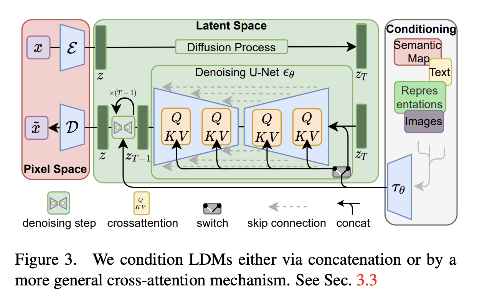
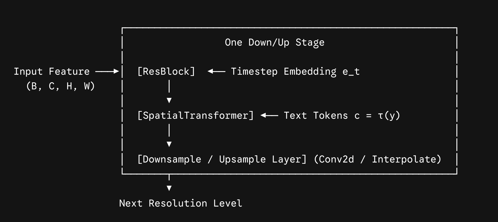



## 1. Summary

The **latent diffusion model** (**LDM**) decouples the image generative process into two explicit stages: perceptual compression with autoencoder and  semantic compression with diffusion model.  It turns out to be a simple and efficient way to significantly improve both the training and sampling efficiency of denoising diffusion models without degrading their quality. LDMs achieve new state-of-the-art scores for **image inpainting** and **class-conditional image synthesis** and highly competitive performance on various tasks, including **text-to-image synthesis, unconditional image generation and super-resolution**.

## 2. Method

### Stage 1: Perceptual Compression (Autoencoder $\mathcal{E}$ and $\mathcal{D}$)

- An autoencoder is pre-trained with a combination of perceptual loss (LPIPS) and patch-based adversarial objectives (PatchGAN).
- The encoder $\mathcal{E}$ maps an image $x \in \mathbb{R}^{H \times W \times 3}$ into a latent representation $z = \mathcal{E}(x) \in \mathbb{R}^{h \times w \times c}$, where downsampling factor $f = H/h = W/w = 2^m$ (typically $f \in \{4, 8\}$).
- Two regularizations were tested to avoid arbitrarily scaled latent spaces:
	- **KL-reg:** A mild Kullback-Leibler penalty toward a standard normal distribution (akin to a VAE).
	- **VQ-reg:** Vector quantization integrated inside the decoder (akin to VQ-GAN).

### Stage 2: Latent Diffusion Model (LDM)

- The diffusion process operates entirely on the compact latent space $z$.
- The training objective predicts the injected noise $\epsilon$:

$$
\mathcal{L}_{\text{LDM}} = \mathbb{E}_{\mathcal{E}(x), \epsilon \sim \mathcal{N}(0, 1), t}\left[ \Vert{}\epsilon - \epsilon_\theta(z_t, t, \tau_\theta(y))\Vert{}_2^2 \right]
$$

- Because the latent representation has $4\times$ to $8\times$ smaller spatial dimensions, inference and training speeds improve by an order of magnitude.

### Stage 3: Flexible Multimodal Conditioning via Cross-Attention

- To enable general-purpose conditional generation (text-to-image, layout-to-image, bounding boxes, semantic maps), the authors augmented the denoising U-Net with **cross-attention mechanisms**.
- Input conditioning $y$ (such as text tokens) is encoded using a domain-specific encoder $\tau_\theta(y)$ (e.g., a pre-trained BERT or CLIP text transformer).
- Cross-attention layers are inserted between intermediate convolutions of the U-Net:

  $$
  \text{Attention}(Q, K, V) = \text{softmax}\left(\frac{QK^T}{\sqrt{d}}\right)V
  $$

  where $Q = W_Q \cdot \phi_i(z_t)$ (intermediate feature representation of the U-Net) and $K = W_K \cdot \tau_\theta(y)$, $V = W_V \cdot \tau_\theta(y)$.


## 3. Key Mathematical Formulations

### The Pretrained VAE

The pretrained VAE bridges the gap between high-dimensional raw pixel space and a low-dimensional semantic latent manifold — handling the high-frequency perceptual details (textures, fine lines, imperceptible noise) so the diffusion model doesn't have to waste parameter capacity modeling them. The VAE consists of two distinct components: the **Encoder $\mathcal{E}$** and the **Decoder $\mathcal{D}$**.

#### Encoder $\mathcal{E}$

- **Input:** Raw RGB image $x \in \mathbb{R}^{H \times W \times 3}$ (pixel values normalized to $[-1, 1]$).
	- *Example:* A $512 \times 512 \times 3$ image (786,432 scalar values).
- **Output:** Mean $\mu$ and log-variance $\log \sigma^2$ parameterizing the latent distribution:

$$
q_\phi(z \mid x) = \mathcal{N}\left(z;\, \mu(x),\, \sigma^2(x)\mathbf{I}\right)
$$

Using the reparameterization trick ($z = \mu + \sigma \odot \epsilon$), we sample latent tensor $z \in \mathbb{R}^{h \times w \times c}$, where $h = H/f$, $w = W/f$, downsampling factor $f=8$, and latent channels $c=4$.

- *Example:* Shape becomes $64 \times 64 \times 4$ (16,384 scalar values, a **48× reduction**).

#### Decoder $\mathcal{D}$

- **Input:** Latent representation $z \in \mathbb{R}^{\frac{H}{f} \times \frac{W}{f} \times c}$ (either an encoded image or the clean output $z_0$ generated by the diffusion U-Net).
- **Output:** Reconstructed RGB image $\tilde{x} = \mathcal{D}(z) \in \mathbb{R}^{H \times W \times 3}$.

#### Loss function

$$
\mathcal{L}_{\text{total}} = \mathcal{L}_{\text{rec}} + \lambda_{\text{perceptual}}\mathcal{L}_{\text{LPIPS}} + \lambda_{\text{adv}}\mathcal{L}_{\text{adv}} + \lambda_{\text{KL}}\mathcal{L}_{\text{KL}}
$$

**A. Pixel Reconstruction Loss ($\mathcal{L}_{\text{rec}}$)**

Measures point-to-point pixel fidelity:

$$
\mathcal{L}_{\text{rec}} = \Vert{}x - \tilde{x}\Vert{}_1
$$

$L_1$ loss is generally preferred over $L_2$ because it is less prone to over-smoothing edges.

**B. Perceptual Loss ($\mathcal{L}_{\text{LPIPS}}$)**

Uses a frozen pretrained vision network (typically VGG or AlexNet) to evaluate feature similarity across hidden deep layers:

$$
\mathcal{L}_{\text{LPIPS}} = \sum_{l} \frac{1}{H_l W_l} \Vert{}\phi_l(x) - \phi_l(\tilde{x})\Vert{}_2^2
$$

This penalizes distortions in semantic patterns and mid-level structures rather than raw pixel-by-pixel offsets.

**C. Patch-Based Adversarial Loss ($\mathcal{L}_{\text{adv}}$)**

A PatchGAN discriminator $D_\psi$ is trained simultaneously against the VAE:

- Instead of judging the entire image as real or fake, the discriminator evaluates local $N \times N$ patches.
- This forces the decoder $\mathcal{D}$ to synthesize crisp, realistic micro-textures (skin pores, fabric weaves, foliage edges) that pixel-level losses cannot capture.

$$
\mathcal{L}_{\text{adv}} = \log D_\psi(x) + \log(1 - D_\psi(\mathcal{D}(z)))
$$

**D. Latent Space Regularization ($\mathcal{L}_{\text{KL}}$)**

Without regularization, the encoder could map latents to arbitrarily large magnitudes and isolated clusters, creating massive "dead zones" where the diffusion model cannot learn a smooth manifold.

A mild KL divergence penalty is applied between the predicted posterior and a standard isotropic Gaussian:

$$
\mathcal{L}_{\text{KL}} = \mathcal{D}_{\text{KL}}\left( q_\phi(z \mid x) \,\Vert{}\, \mathcal{N}(\mathbf{0}, \mathbf{I}) \right)
$$

In LDMs, the weight $\lambda_{\text{KL}}$ is kept **very small** (e.g., $10^{-6}$). A strong KL penalty causes fuzzy reconstructions; a mild penalty is just enough to keep the latent space bounded and well-behaved for the diffusion U-Net.

### The Latent Scaling Factor Trick
During the diffusion phase, the variance of the latents needs to match standard diffusion assumptions (unit variance $\approx 1$).

Because the VAE encoder outputs latents with an arbitrary standard deviation (often around $\sigma_z \approx 0.18$), the authors compute a fixed empirical scaling factor $s$:

$$z_{\text{scaled}} = s \cdot \mathcal{E}(x)$$

In Stable Diffusion v1.x/v2.x, this constant is hardcoded as:

$$s = 0.18215$$

When sampling, the denoised latent $\hat{z}_0$ is unscaled before passing to the decoder:

$$\tilde{x} = \mathcal{D}\left(\frac{\hat{z}_0}{0.18215}\right)$$
### The Spatial Transformer Block

In Latent Diffusion Models (LDMs / Stable Diffusion), Transformers are introduced inside the U-Net as **Spatial Transformer blocks** (often termed `SpatialTransformer` in the CompVis codebase).

Rather than replacing the convolutional backbone, these blocks are inserted between residual convolutional blocks at lower spatial resolutions (typically $32 \times 32$, $16 \times 16$, and $8 \times 8$). They act as a hybrid bridge, allowing the 2D visual feature maps to attend to external conditional sequences (like text prompt embeddings) via **Cross-Attention**, while simultaneously modeling global pixel-to-pixel context via **Self-Attention**.

#### 1. Architectural Placement of the Spatial Transformer Block

Each downsampling and upsampling stage in the LDM U-Net consists of:

1. **ResNet Block:** Ingests local feature maps + timestep embedding $e_t$ via convolutions and AdaGN/addition.
2. **Spatial Transformer Block:** Ingests the 2D feature map and the conditioning sequence $c = \tau(y)$.
3. **Downsample / Upsample Layer:** Strided convolution or interpolation.

#### 2. The Reshape & Sequence Flattening Trick

Standard Transformer attention expects a sequence tensor of shape `(Batch, Sequence_Length, Hidden_Dim)`, whereas CNN feature maps are 4D tensors `(Batch, Channels, Height, Width)`.

The Spatial Transformer bridges this using spatial flattening:

**Flattening** — the spatial grid $H \times W$ is flattened into a 1D sequence of length $N = H \cdot W$:

$$
h \in \mathbb{R}^{B \times C \times H \times W} \xrightarrow{\text{permute \& reshape}} h_{\text{seq}} \in \mathbb{R}^{B \times (H \cdot W) \times C}
$$

Each spatial pixel location $(i, j)$ in the latent feature map becomes a single token of dimension $C$.

**Unflattening (after Transformer processing):**

$$
h_{\text{out\_seq}} \in \mathbb{R}^{B \times (H \cdot W) \times C} \xrightarrow{\text{reshape \& permute}} h_{\text{out}} \in \mathbb{R}^{B \times C \times H \times W}
$$

A residual connection adds $h_{\text{out}}$ directly back to the original convolutional feature map.

#### 3. Inside the `BasicTransformerBlock`: Two Attention Stages

Once flattened into visual tokens $h_{\text{seq}}$, each transformer block executes two distinct attention operations.

**3A. Spatial Self-Attention (Visual Context)**

Models long-range spatial correlations across the image itself (overcoming the local receptive field of convolutions):

$$
Q = W_Q h_{\text{seq}}, \quad K = W_K h_{\text{seq}}, \quad V = W_V h_{\text{seq}}
$$

$$
\text{SelfAttn}(h_{\text{seq}}) = \text{softmax}\left(\frac{Q K^T}{\sqrt{d_k}}\right) V
$$

Followed by a residual addition and LayerNorm.

**3B. Cross-Attention (Multimodal Conditioning)**

Fuses the visual tokens with the external text embeddings. Let text condition tokens be $c = \tau(y) \in \mathbb{R}^{B \times L \times d_{\text{text}}}$ (e.g., $L=77$ tokens from CLIP ViT-L/14, $d_{\text{text}}=768$).

- **Queries ($Q$)** come strictly from the **visual tokens**:

$$
Q = W_Q^{(c)} \cdot h_{\text{seq}} \quad \in \mathbb{R}^{B \times (H \cdot W) \times d}
$$

- **Keys ($K$) and Values ($V$)** come strictly from the **text tokens**:

$$
K = W_K^{(c)} \cdot c \quad \in \mathbb{R}^{B \times L \times d}
$$

$$
V = W_V^{(c)} \cdot c \quad \in \mathbb{R}^{B \times L \times d}
$$

- The attention matrix is computed as:

$$
\text{CrossAttn}(h_{\text{seq}}, c) = \text{softmax}\left(\frac{Q K^T}{\sqrt{d}}\right) V
$$

The intermediate attention matrix $\frac{QK^T}{\sqrt{d}}$ has shape `(B, Heads, H·W, L)`. Each entry $(n, m)$ represents how much spatial location $n$ in the image attends to word token $m$ in the prompt.

Followed by residual connection, LayerNorm, and a feed-forward MLP (usually with GEGLU activations).
#### 4. Code
```python
import torch
import torch.nn as nn
from einops import rearrange

class CrossAttention(nn.Module):
    def __init__(self, query_dim: int, context_dim: int, heads: int = 8, dim_head: int = 64):
        super().__init__()
        inner_dim = dim_head * heads
        self.scale = dim_head ** -0.5
        self.heads = heads

        self.to_q = nn.Linear(query_dim, inner_dim, bias=False)
        self.to_k = nn.Linear(context_dim, inner_dim, bias=False)
        self.to_v = nn.Linear(context_dim, inner_dim, bias=False)
        self.to_out = nn.Linear(inner_dim, query_dim)

    def forward(self, x: torch.Tensor, context: torch.Tensor = None) -> torch.Tensor:
        # x: (B, N, query_dim) where N = H * W
        # context: (B, L, context_dim) where L is text token length (e.g. 77)
        if context is None:
            context = x  # Self-Attention mode

        q = self.to_q(x)
        k = self.to_k(context)
        v = self.to_v(context)

        # Split heads: (B, Heads, Tokens, Dim_Head)
        q = rearrange(q, 'b n (h d) -> (b h) n d', h=self.heads)
        k = rearrange(k, 'b l (h d) -> (b h) l d', h=self.heads)
        v = rearrange(v, 'b l (h d) -> (b h) l d', h=self.heads)

        # Attention weights: (B * Heads, N, L)
        sim = torch.einsum('b i d, b j d -> b i j', q, k) * self.scale
        attn = sim.softmax(dim=-1)

        # Aggregate values: (B * Heads, N, Dim_Head)
        out = torch.einsum('b i j, b j d -> b i d', attn, v)
        out = rearrange(out, '(b h) n d -> b n (h d)', h=self.heads)
        return self.to_out(out)

class SpatialTransformer(nn.Module):
    """Bridge between 2D Conv feature maps and Sequence Attention."""
    def __init__(self, in_channels: int, context_dim: int, heads: int = 8, dim_head: int = 64):
        super().__init__()
        self.norm = nn.GroupNorm(32, in_channels)
        self.proj_in = nn.Conv2d(in_channels, in_channels, kernel_size=1)

        # 1. Self-Attention (Visual tokens attend to visual tokens)
        self.attn1 = CrossAttention(in_channels, in_channels, heads, dim_head)
        self.norm1 = nn.LayerNorm(in_channels)

        # 2. Cross-Attention (Visual tokens attend to text tokens)
        self.attn2 = CrossAttention(in_channels, context_dim, heads, dim_head)
        self.norm2 = nn.LayerNorm(in_channels)

        # 3. Feed-forward block
        self.ff = nn.Sequential(
            nn.Linear(in_channels, in_channels * 4),
            nn.GELU(),
            nn.Linear(in_channels * 4, in_channels)
        )
        self.norm3 = nn.LayerNorm(in_channels)
        self.proj_out = nn.Conv2d(in_channels, in_channels, kernel_size=1)

    def forward(self, x: torch.Tensor, context: torch.Tensor) -> torch.Tensor:
        b, c, h, w = x.shape
        residual = x

        # 1. Project and flatten 2D map to sequence
        x_in = self.proj_in(self.norm(x))
        x_seq = rearrange(x_in, 'b c h w -> b (h w) c')

        # 2. Self-Attention
        x_seq = self.attn1(self.norm1(x_seq)) + x_seq

        # 3. Cross-Attention with text context tokens
        x_seq = self.attn2(self.norm2(x_seq), context=context) + x_seq

        # 4. Feed-forward
        x_seq = self.ff(self.norm3(x_seq)) + x_seq

        # 5. Reshape back to 2D image map
        x_out = rearrange(x_seq, 'b (h w) c -> b c h w', h=h, w=w)
        return self.proj_out(x_out) + residual
```
## 4. Personal Insights

### Integrate SpatialTransformer into U-Net
In the Latent Diffusion Model (LDM / Stable Diffusion) codebase (`open_clip` / CompVis / Diffusers), the `SpatialTransformer` module is not placed in isolation. Instead, it is paired directly alongside ResNet blocks inside composite containers called **`TimestepEmbedSequential`** (or `UNetMidBlock2DCrossAttn` / `CrossAttnDownBlock2D` in Hugging Face Diffusers).

Here is the exact structural and programmatic wiring showing how it integrates into the U-Net.

#### 1. Structural Blueprint: The Macro Block Unit

The U-Net is organized into three major sections:

1. **Down-sampling Path (Encoder):** 4 stages ($64 \times 64 \to 32 \times 32 \to 16 \times 16 \to 8 \times 8$).
    
2. **Mid Block (Bottleneck):** Fixed at the lowest resolution ($8 \times 8$).
    
3. **Up-sampling Path (Decoder):** 4 mirrored stages ($8 \times 8 \to 16 \times 16 \to 32 \times 32 \to 64 \times 64$) with skip-connections.
    
Whenever conditioning (like text) is enabled, each resolution level is packaged into repetitive blocks that chain convolutions with spatial transformers:

#### 2. The Container: `TimestepEmbedSequential`

A standard PyTorch `nn.Sequential` container only passes a single argument `x` between layers: `x = layer(x)`.

Because a ResNet block needs $(h, e_t)$ and a `SpatialTransformer` needs $(h, c)$, the LDM architecture defines a custom sequential wrapper:
```python
import torch.nn as nn

class TimestepEmbedSequential(nn.Sequential):
    """
    A Sequential container that inspects each child layer and routes 
    the timestep embedding (emb) and context (context) dynamically.
    """
    def forward(self, x, emb=None, context=None):
        for layer in self:
            if isinstance(layer, ResnetBlock):
                # ResNet takes spatial features and timestep embedding
                x = layer(x, emb)
            elif isinstance(layer, SpatialTransformer):
                # SpatialTransformer takes spatial features and text condition
                x = layer(x, context)
            else:
                # Convolutions, Downsample, Upsample
                x = layer(x)
        return x
```
#### 3. Assembling the Full U-Net (Code Layout)

Below is the concrete integration of `SpatialTransformer` across the Down, Middle, and Up stages of the U-Net:
```python
import torch
import torch.nn as nn

class UNetModel(nn.Module):
    def __init__(
        self,
        in_channels=4,          # VAE latent channels
        out_channels=4,
        model_channels=320,     # Base channel multiplier
        channel_mult=(1, 2, 4, 4), # Multipliers -> [320, 640, 1280, 1280]
        num_res_blocks=2,
        context_dim=768,        # CLIP text token embedding dimension
        heads=8,
        dim_head=64
    ):
        super().__init__()
        
        # 1. Timestep MLP projection
        time_embed_dim = model_channels * 4
        self.time_mlp = nn.Sequential(
            SinusoidalPositionEmbeddings(model_channels),
            nn.Linear(model_channels, time_embed_dim),
            nn.SiLU(),
            nn.Linear(time_embed_dim, time_embed_dim),
        )

        # 2. Input convolution to map latent to base channel size
        self.conv_in = nn.Conv2d(in_channels, model_channels, kernel_size=3, padding=1)

        # 3. Downsampling Blocks (Encoder)
        self.down_blocks = nn.ModuleList()
        ch = model_channels

        for level, mult in enumerate(channel_mult):
            out_ch = model_channels * mult
            for _ in range(num_res_blocks):
                layers = [ResnetBlock(ch, out_ch, time_embed_dim)]
                ch = out_ch
                
                # Insert SpatialTransformer at levels 1, 2, 3 (skip level 0: 64x64)
                if level > 0:
                    layers.append(
                        SpatialTransformer(ch, context_dim, heads=heads, dim_head=dim_head)
                    )
                self.down_blocks.append(TimestepEmbedSequential(*layers))

            # Downsample between stages (except last level)
            if level != len(channel_mult) - 1:
                self.down_blocks.append(
                    TimestepEmbedSequential(nn.Conv2d(ch, ch, kernel_size=3, stride=2, padding=1))
                )

        # 4. Middle Block (Bottleneck at 8x8)
        self.mid_block = TimestepEmbedSequential(
            ResnetBlock(ch, ch, time_embed_dim),
            SpatialTransformer(ch, context_dim, heads=heads, dim_head=dim_head),
            ResnetBlock(ch, ch, time_embed_dim),
        )

        # 5. Upsampling Blocks (Decoder) with Skip Connections
        self.up_blocks = nn.ModuleList()
        for level, mult in reversed(list(enumerate(channel_mult))):
            out_ch = model_channels * mult
            for _ in range(num_res_blocks + 1):
                # Account for concatenated skip connections from down_blocks
                skip_ch = ch  
                layers = [ResnetBlock(ch + skip_ch, out_ch, time_embed_dim)]
                ch = out_ch
                
                if level > 0:
                    layers.append(
                        SpatialTransformer(ch, context_dim, heads=heads, dim_head=dim_head)
                    )
                self.up_blocks.append(TimestepEmbedSequential(*layers))

            # Upsample between stages (except level 0)
            if level > 0:
                self.up_blocks.append(
                    TimestepEmbedSequential(nn.Upsample(scale_factor=2, mode="nearest"),
                                            nn.Conv2d(ch, ch, kernel_size=3, padding=1))
                )

        # 6. Final Projection back to latent shape
        self.norm_out = nn.GroupNorm(32, ch)
        self.conv_out = nn.Conv2d(ch, out_channels, kernel_size=3, padding=1)
```
#### 4. Tensor Flow During the Forward Pass
During a single denoising step, tensors pass through the integrated pipeline in this exact order:
```python
def forward(self, x, timesteps, context):
        """
        x: Corrupted latent z_t, shape: (B, 4, 64, 64)
        timesteps: Discrete step t, shape: (B,)
        context: Text embeddings from CLIP τ(y), shape: (B, 77, 768)
        """
        # 1. Compute time embedding
        t_emb = self.time_mlp(timesteps)  # (B, 1280)

        # 2. Initial convolution
        h = self.conv_in(x)               # (B, 320, 64, 64)

        # 3. Down-path (Store intermediate outputs for skip connections)
        saved_skips = []
        for block in self.down_blocks:
            h = block(h, emb=t_emb, context=context)
            saved_skips.append(h)

        # 4. Middle Bottleneck
        h = self.mid_block(h, emb=t_emb, context=context)

        # 5. Up-path (Concatenate corresponding skip-connection tensor along channel dim)
        for block in self.up_blocks:
            skip = saved_skips.pop()
            h = torch.cat([h, skip], dim=1)  # Concatenate along channel axis
            h = block(h, emb=t_emb, context=context)

        # 6. Output noise prediction
        h = torch.nn.functional.silu(self.norm_out(h))
        eps_pred = self.conv_out(h)       # (B, 4, 64, 64)
        
        return eps_pred
```