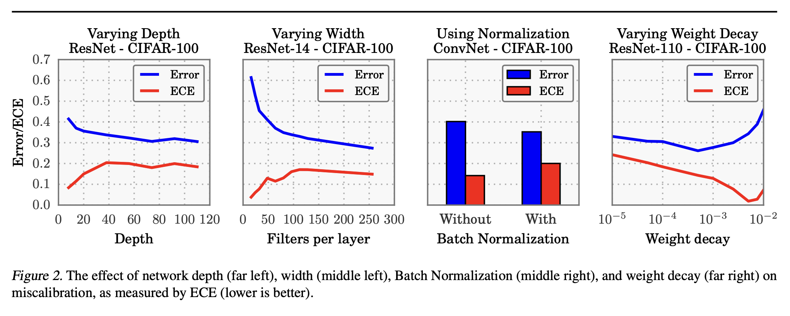
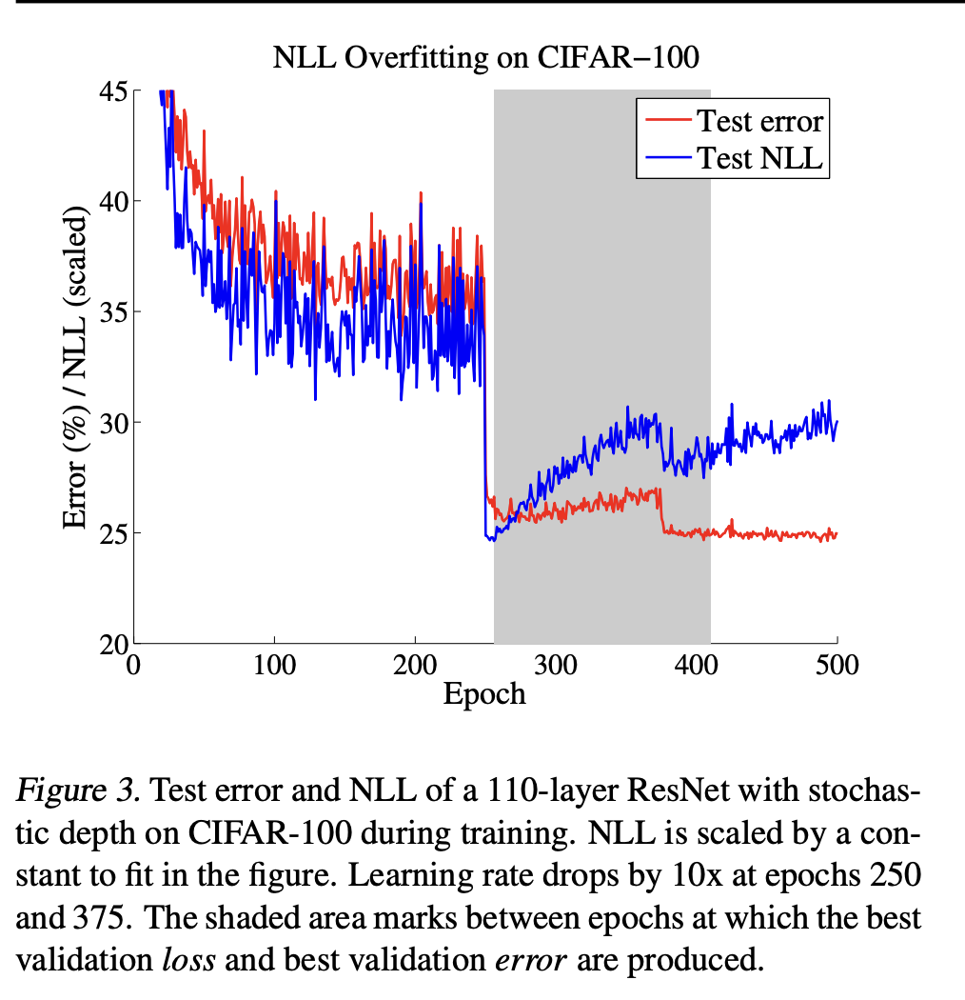



## 1. Summary

The paper investigates whether the probabilities of modern deep neural network classifier  represents  the true correctness likelihood. It observes that **depth, width, weight decay, and Batch Normalization** are important factors influencing calibration. It concludes that temperature scaling is surprisingly effective at calibrating predictions.
## 2. Method
#### Perfect Calibration
Let $X \in \mathcal{X}$ and $Y \in \mathcal{Y} = \{1, \ldots, K\}$ be random variables with joint distribution

$$
\pi(X, Y) = \pi(Y \mid X)\, \pi(X).
$$

A neural network $h : \mathcal{X} \to \mathcal{Y} \times [0, 1]$ outputs

$$
h(X) = (\hat{Y}, \hat{P}),
$$
where $\hat{Y}$ is the class prediction and $\hat{P}$ is its associated confidence (probability of correctness).
A classifier is **well-calibrated** if its predicted confidence matches its empirical accuracy:
$$\mathbb{P}(\hat{Y} = Y \mid \hat{P} = p) = p, \quad \forall p \in [0, 1]$$
(e.g., of all predictions made with 80% confidence, roughly 80% should be correct). in which 

#### Accuracy and Confidence
To estimate the expected accuracy from finite samples, we group predictions into $M$ interval bins (each of size $1/M$) and calculate the accuracy of each bin. Let $B_m$ be the set of indices of samples whose prediction confidence falls into the interval $I_m = \left(\frac{m-1}{M}, \frac{m}{M}\right]$. The accuracy of $B_m$ is

$$
\operatorname{acc}(B_m) = \frac{1}{|B_m|} \sum_{i \in B_m} \mathbf{1}(\hat{y}_i = y_i),
$$

where $\hat{y}_i$ and $y_i$ are the predicted and true class labels for sample $i$. Basic probability tells us that $\operatorname{acc}(B_m)$ is an unbiased and consistent estimator of $\mathbb{P}(\hat{Y} = Y \mid \hat{P} \in I_m)$. We define the average confidence within bin $B_m$ as

$$
\operatorname{conf}(B_m) = \frac{1}{|B_m|} \sum_{i \in B_m} \hat{p}_i,
$$

where $\hat{p}_i$ is the confidence for sample $i$.
#### Reliability Diagrams
Plots of sample accuracy versus predicted confidence, computed by partitioning predictions into $M$ confidence bins $B_m \subset (0, 1]$. In a well-calibrated model, bars follow the identity diagonal ($y = x$).

#### Expected Calibration Error (ECE)
The weighted average of the absolute difference between bin accuracy and bin confidence:

$$\text{ECE} = \sum_{m=1}^M \frac{\vert{}B_m\vert{}}{n} \big\vert{}\text{acc}(B_m) - \text{conf}(B_m)\big\vert{}$$

#### Maximum Calibration Error (MCE)
The worst-case gap across all bins: $\max_{m} \vert{}\text{acc}(B_m) - \text{conf}(B_m)\vert{}$.

#### Negative Log-Likelihood (NLL / Cross-Entropy)
Standard probabilistic loss metric; minimized if and only if the model recovers the true conditional distribution. $$
\mathcal{L} = -\sum_{i=1}^{n} \log \hat{\pi}(y_i \mid x_i)
$$
## 3. What Causes Miscalibration in Modern Nets?
#### Model Capacity (Depth and Width)
Deeper and wider networks achieve lower classification error, but their ECE rises dramatically. Once training samples are classified correctly, cross-entropy training continues driving loss down by pushing logits to extreme magnitudes, inflating confidence without improving accuracy.
#### Batch Normalization
While improving convergence speed and final accuracy, batch normalization noticeably degrades calibration.
#### Weight Decay
Stronger $L_2$ regularization significantly improves calibration by preventing logits from scaling up unchecked. Modern pipelines often use weaker weight decay to maximize classification accuracy.


#### NLL Overfitting vs. 0/1 Error
During extended training, test error plateaus while test NLL starts rising (overfitting in probability space, even when accuracy remains unaffected. Even more, overfitting to NLL is beneficial to classification accuracy.)


## 4. Calibration Methods  

#### Temperature Scaling is the clear winner
Optimizing a single parameter $T$ (where $T > 1$ softens overconfident distributions) directly on validation NLL drastically reduces ECE—often by an order of magnitude—while strictly preserving top-1 accuracy. The method applies to the logit vector $z(x)$ before the softmax:

$$\hat{p}_i = \frac{\exp(z_i / T)}{\sum_j \exp(z_j / T)}$$
#### End-to-End Practical Implementation Recipe
- **Step 1 Collect Validation Logits**:Reserve a held-out calibration/validation set
```python
import torch
import torch.nn as nn
import torch.optim as optim

# Collect raw logits z and ground-truth labels y from validation data
# Shapes: val_logits -> (N, K), val_labels -> (N,)
```
- **Step 2 Fit Temperature $T$ via NLL**: Optimize a single scalar parameter $T$ using cross-entropy loss with the base network weights frozen.
```python
class TemperatureScaler(nn.Module):
    def __init__(self):
        super().__init__()
        # Initialize T = 1.0 (log_temperature = 0.0 for unconstrained optimization)
        self.log_temperature = nn.Parameter(torch.zeros(1))

    @property
    def temperature(self):
        return torch.exp(self.log_temperature)

    def forward(self, logits):
        return logits / self.temperature

    def fit(self, val_logits, val_labels, lr=0.01, max_iter=50):
        optimizer = optim.LBFGS([self.log_temperature], lr=lr, max_iter=max_iter)
        criterion = nn.CrossEntropyLoss()

        def eval_loss():
            optimizer.zero_grad()
            scaled_logits = self.forward(val_logits)
            loss = criterion(scaled_logits, val_labels)
            loss.backward()
            return loss

        optimizer.step(eval_loss)
        return self.temperature.item()  
```
- **Step 3 Serve in Production**: Store $T$ as a model configuration parameter. At inference time, scale logits before computing softmax probabilities
```python
# During online inference / batch serving:
T = 1.48  # Fitted scalar from validation
calibrated_probs = torch.softmax(raw_logits / T, dim=-1)  
```
