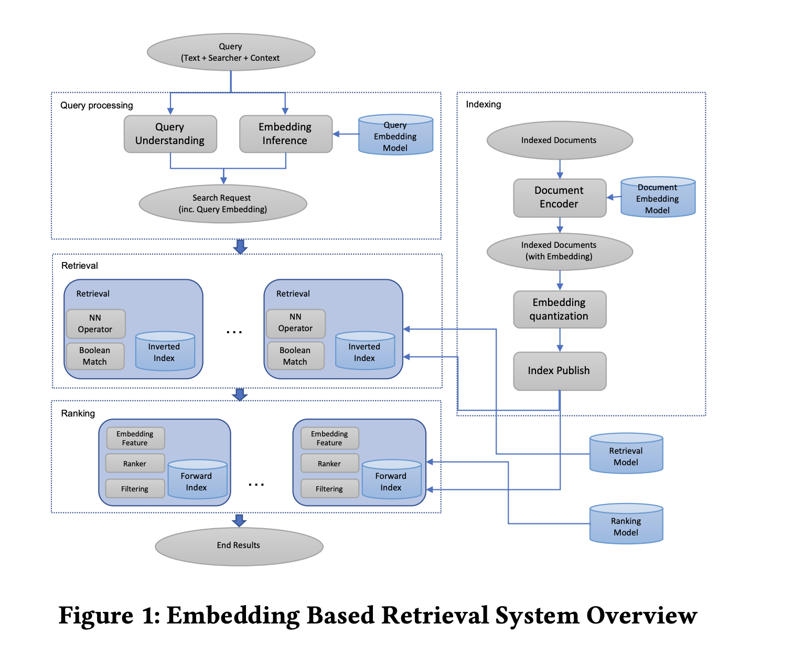
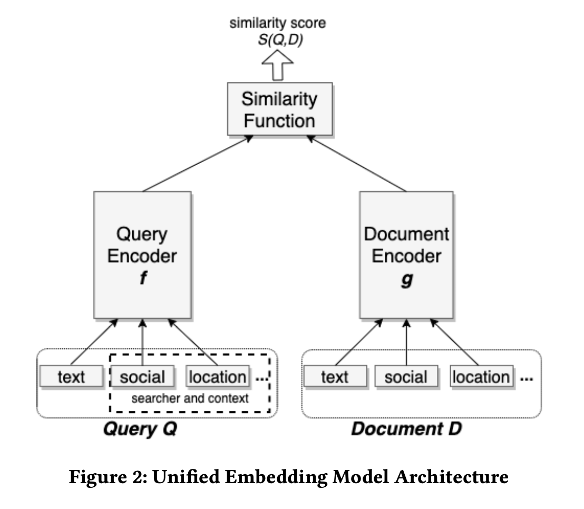
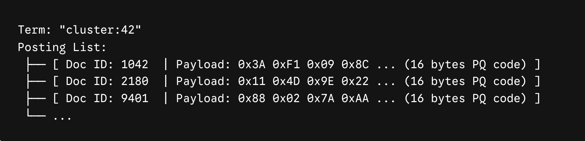



## 1. Summary

The paper provides an end-to-end blueprint for designing, serving, and optimizing an Embedding-Based Retrieval (**EBR**) system in a production social search engine (**Unicorn**). The embedding encodes the search request and document respectively to create a **two-tower** neural network for search retrieval, with clicks from logs as positive instances and random as negative instances. Ultimately the embedding retrieval is integrated into inverted index search.

## 2. System Architecture

## 3. Method

#### Recall@K

The search retrieval task is formulated as a recall optimization problem: given a search query, its target result set $T = \{t_1, t_2, \ldots, t_N\}$, and top $K$ results returned by a model $\{d_1, d_2, \ldots, d_K\}$, we want to maximize recall by the top $K$ results:

$$
\operatorname{recall@}K = \frac{\sum_{i=1}^{K} \mathbf{1}[d_i \in T]}{N}
$$
#### Loss Function

The model is trained using **triplet loss** with cosine distance:

$$\mathcal{L} = \sum_{i=1}^N \max\Big(0, \, \mathcal{D}(q^{(i)}, d^{(i)+}) - \mathcal{D}(q^{(i)}, d^{(i)-}) + m\Big)$$
For a given triplet $\bigl(q^{(i)},\, d^{(i)}_+,\, d^{(i)}_-\bigr)$, where $q^{(i)}$ is a query, and $d^{(i)}_+$ and $d^{(i)}_-$ are the associated positive and negative documents.
while distance metric between a query vector $u$ and a document vector $v$ is explicitly defined as **cosine distance**
$$\mathcal{D}(u, v) = 1 - \cos(u, v) = 1 - \frac{\langle u, v \rangle}{\Vert{}u\Vert{}_2 \, \Vert{}v\Vert{}_2}$$
tuning the margin $m$ is critical (accounting for 5–10% variance in recall).
Offline progress is measured using **Recall@K** over thousands of sampled real search sessions
#### Unified Embedding Model 

The **two-tower** model consists of two encoders (*An encoder is a neural network which transforms an input into a low-dimensional dense vector, also known as embedding*): A query encoder $E_Q = f(Q)$ which produces a query embedding, and a document encoder $E_D = g(D)$ which produces a document embedding. The two encoders by default are two separate networks but have the option of sharing part of the parameters. **The inputs to the encoders are more than texts** (e.g. searcher location and social connections for queries, aggregated location and social clusters about a Facebook group for documents)

#### Feature Engineering

- **Text Features** (e.g. Query string, Entity name/title): **character n-gram** ($+1.5\%$ recall gain with word n-gram in addition)
- **Location Features** (e.g. searcher city, region, country, and language on query side, group location on document side): Categorical IDs mapped to **trainable dense embedding tables**, pooled, and concatenated ($+2.20\%$ recall gain)
- **Social Embedding Features** (e.g. users, entities in the social network): Pre-trained graph embeddings ($+1.77\%$ recall gain)
- The continuous representations for text, location, and graph IDs are concatenated into a wide vector$$x = [e_{\text{text}} \,\Vert{}\, e_{\text{location}} \, \,\Vert{}\, e_{\text{social}}]$$ which is fed into 2–3 dense feedforward layers with non-linear activations (ReLU) to allow the network to learn non-linear feature interactions.

#### Hard negative mining

- using **clicks** (or impressions) as positive and **random** (or non-click impressions) as negative can provide a reasonable model performance. 
- Counterintuitively, models trained simply using hard negatives **cannot** outperform models trained with random negatives. 
- **blending** random and hard negatives in training is advantageous. Increasing the ratio of easy to hard negatives continues to improve the model recall and saturated at easy:hard=**100:1**
## 4. How does nn operator work

In search engines like Lucene or Facebook's Unicorn, a **"term"** is the fundamental key part of the inverted index—conceptually a tuple of `(field, value)` mapped to a posting list that represents a list of documents. Systems regularly use synthetic or derived identifiers as terms (e.g., `friend:12345`, `tag:verified`, `location:94025`).

During offline indexing, the embedding vector space is split into $K$ total clusters, say $K = 65{,}536$. Each document (e.g. Doc ID 1042) vector $v_d$ is assigned to its nearest **coarse centroid** $C_k$ (e.g. 42) and the residual vector $r = v_d - C_k$ is quantized into Product Quantization (PQ) codes (e.g., 8–16 bytes "0x3A 0xF1 0x09 0x8C ..."). Hence the inverted index that takes cluster centroids as inverted index terms looks like as follows

Hybrid retrieval expressions, with arbitrary combinations of embeddings and terms are supported. Given a query ***(and (term "friend:12345") (nn model-141795009 :radius 0.24 :nprobe 16)***), the Unicorn first resolves the key **model-141795009** and  fetches query vector $v_q$. Next, it probes top 16 centroids (**:nprobe 16**) and filters posting lists by **:radius 0.24** (here using residual vector $r$). At the same time, the Unicorn evaluates boolean query conjunctions (`AND`) using standard posting list skipping algorithms (like WAND or block-skip pointers). Furthermore, all inverted indexes can be handled with unified storage, sharding, and consistency.

The Unicorn compiled Faiss’s **Inverted File with Product Quantization (IVFPQ)** algorithms directly onto the search engine's inverted index data structures. 
## 5. Personal Insights
#### Multi-Stage ranking
A modern search engine system is a complex multi-stage ranking system where each stage progressively refines the results from the preceding stage.  At large it has 3 layers:
- Retrieval Layer **(L0)** (e.g. Boolean Term Matcher or EBR) that returns ~10k candidates
- First-Stage Ranker **(L1)** (e.g. Linear Ranker such as LTR/GBDT/XGBoost that returns ~1k candidates)
- Second-Stage Ranker **(L2)** (e.g. Deep Neural Network (DLRM-style) with hundreds of sparse/dense features that returns ~10 results)

As being trained on data by old L0, rankers (L1/L2) might assigned poor scores and demoted documents retrieved by new L0. Two approaches are executed to address this issue:

- Add embedding as ranking feature
- Training data feedback loop (logged the results with new L0 and sent for human rating and retrain the ranker)
#### Multi-Task Learning ranking
In production, the L2 ranker is usually a Multi-Task Learning (**MTL**) ranking model that takes these features and outputs distinct predictions (e.g., $P(\text{Click})$, $P(\text{Friend Request})$, $P(\text{Bad Semantic Match})$).

In the end, the system applies the final ranking formula to produce a single scalar sorting score:
$$\text{Final Score} = \alpha \cdot P(\text{Engagement}) + \beta \cdot \text{Score}_{\text{Relevance}} + \gamma \cdot \text{CosineSim} - \lambda \cdot P(\text{Hallucination})$$ and documents are sorted descending by this scalar, and the top $K$ items are rendered on the user's screen.

The Weights ($\alpha, \beta, \gamma, \lambda$) can be calibrated In offline dev, with running grid search, **Pareto frontier optimization**, or Bayesian optimization on replay logs to balance business trade-offs.

The final weights are validated via **online A/B testing** in production before becoming the default live blend.

#### Transformers in L2/L3
In modern production search and recommendation architectures, transformers in L2/L3 are definitely the dominant industry standard in the following scenarios:
- **Long User Sequence Modeling in L2 (User Action Transformers)** Modern L2 rankers (like Alibaba's BST/SIM or Google's Transformers for Recommendations) use multi-head self-attention over chronologically ordered user engagement sequences (past searches, clicks, conversions).
- **Listwise Reranking in L3 (Slate / Mutual Influence Modeling)** Standard L2 rankers score each candidate item independently ($P(Y \mid q, d_i)$). However, in the final display slate, items compete with or complement each other (e.g., showing five identical blue shirts vs. a diverse set of styles). (Like **PRM (Personalized Reranking Model)** or **DLCM**)
- **Cross-Encoder Semantic Scoring in Text-Heavy Verticals** In document search, legal/patent search, and enterprise Q&A, shallow query-document matching struggles with nuanced language. Small distilled cross-encoders (e.g., 3-to-6 layer MiniLM or RoBERTa variants) score the top 50–100 candidates directly:$$\text{Score} = \text{Transformer}(\text{[CLS]} + \text{Query} + \text{[SEP]} + \text{DocText})$$