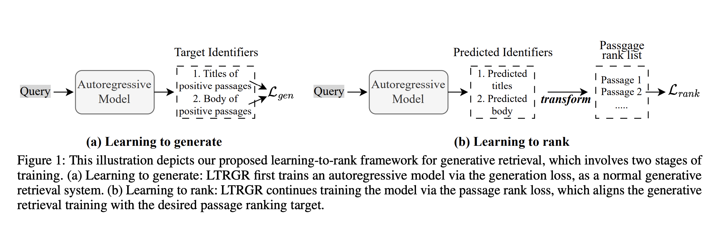



## 1. Summary

**Generative retrieval** trains a sequence-to-sequence model (e.g., BART or T5) to generate document identifiers (DocIDs)—such as titles, numeric IDs, or multiview substrings—directly from a query. However, the generated list of DocIDs does not inherently optimize the top-$k$ passage rank order. **LTRGR** (a learning-to-rank framework for generative retrieval) decouples the training process into two distinct stages: learning to generate and learning to rank to address the issue. Accordingly, BART-Large LTRGR reached **40.2 Recall@5** compared to **29.5** for BART-Large MINDER (+10.7 points) he retrieval process and inference latency remain identical to standard beam-search generative retrieval., showing solid gains across **Recall@5/20/10**0 and **MRR@10**. and, the inference latency remains the same as the standard beam-search generative retrieval. 

While LTRGR set a new state of the art among generative retrieval methods, it still trailed dense retrieval baselines (like **DPR**) at tight cutoffs (e.g., Hits@5/20 on TriviaQA) due to compounding token errors in beam search and lack of direct passage content visibility.

## 2. Method
#####  Stage1: Learning to Generate

**LTRGR** model is pre-trained with standard autoregressive generation loss over target **identifiers** (building upon the **MINDER** framework using multiview identifiers like **titles, substrings, and pseudo-queries**)

The loss function is $$\mathcal{L}_{\text{gen}} = -\sum_{t=1}^{\vert{}y^+\vert{}} \log P_\theta(y_t^+ \mid y_{<t}^+, q)$$ where $y^+ = \text{DocID}(d^+)$ is the sequence of tokens representing the relevant document **identifier**.
##### Stage2: Learning to Rank

Next the pretrained **LTRGR** model takes a query, generates a list of identifiers $I_1, I_2, ..., I_m$ using beam-search. For any candidate DocID $I = (y_1, \dots, y_L)$ is extracted directly from the sequence generation probability:

$$s(q, I) = \log P_\theta(I \mid q) = \sum_{t=1}^L \log P_\theta(y_t \mid y_{<t}, q)$$
As identifiers $Y$ and passages $D$ are many-to-many mapping, **LTRGR** model maps the list of identifiers to a list of distinctive passages $P_1, P_2, ..., P_n$.  For each passage $P$ that aggregates a list of identifiers, $$
s(q, P) = \sum_{I \in I_P} s(q, I)
$$ Where $I_P$ is the set of selected identifiers that appear in the passage $P$. 

Now with the list $q, P_1, P_2, ..., P_n$ including a positive passage $P_+$ and other negative passages $P_-$ , the **LTRGR** model is trained to minimize the two pairwise ranking losses:

- $\mathcal{L}_{\text{rank1}}$ (**Hard Negative Mining**): Selects the **top-2 scoring passages** from the model’s beam search or candidate list
- $\mathcal{L}_{\text{rank2}}$ (**Random** **/ Soft Negative Exploration**): Selects **2 passages uniformly at random** from the broader candidate pool *(random selection for negative only)*
- The loss function is $$
\mathcal{L}_{\text{rank}} = \max\bigl(0,\; s(q, P_-) - s(q, P_+) + m\bigr)
$$
so the overall loss function is: 
$$
\mathcal{L} = \mathcal{L}_{\text{rank}_1} + \mathcal{L}_{\text{rank}_2} + \lambda\, \mathcal{L}_{\text{gen}}
$$ but training is split into two stages.

## 3. Key Mathematical Formulations

## 4. Personal Insights

